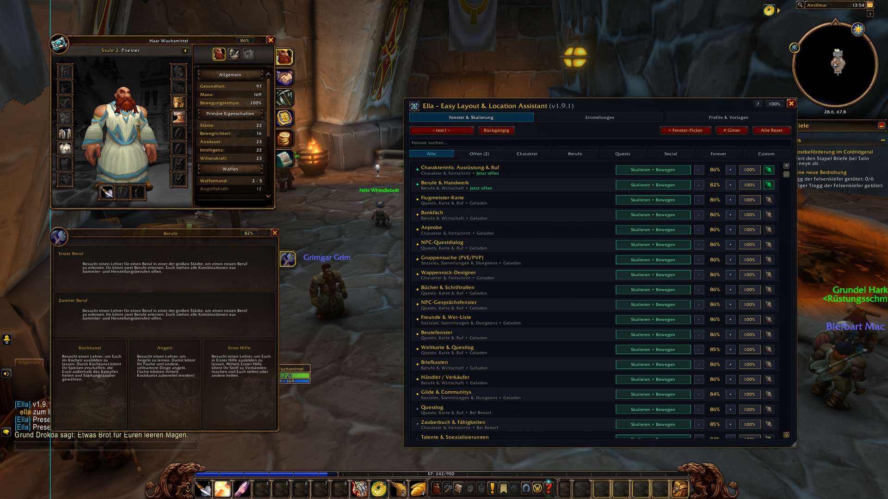
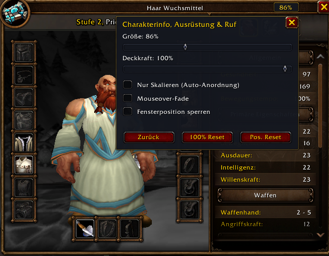
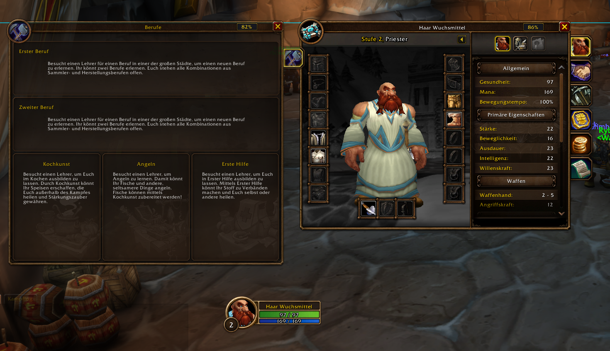
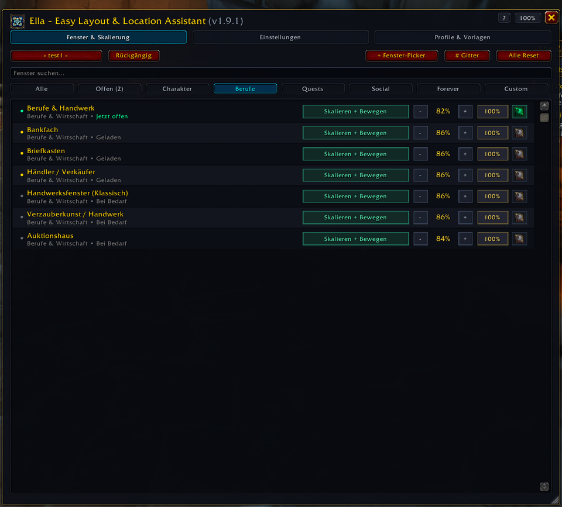
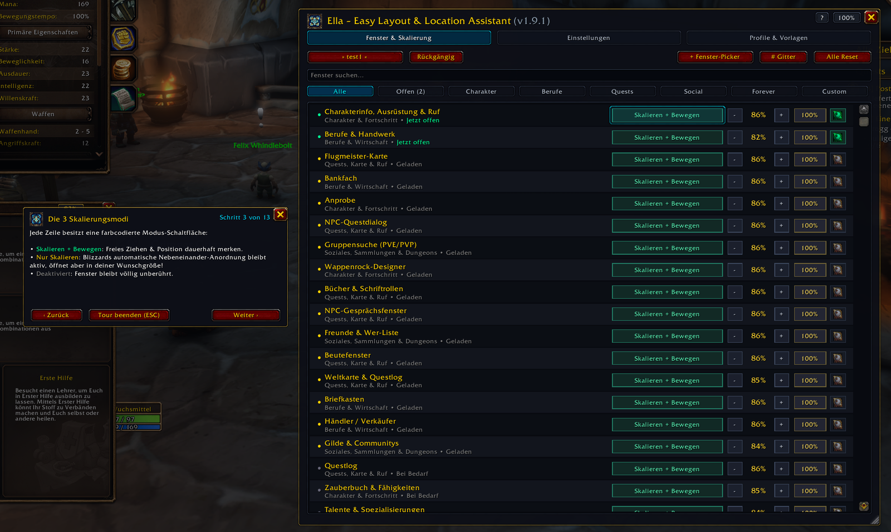
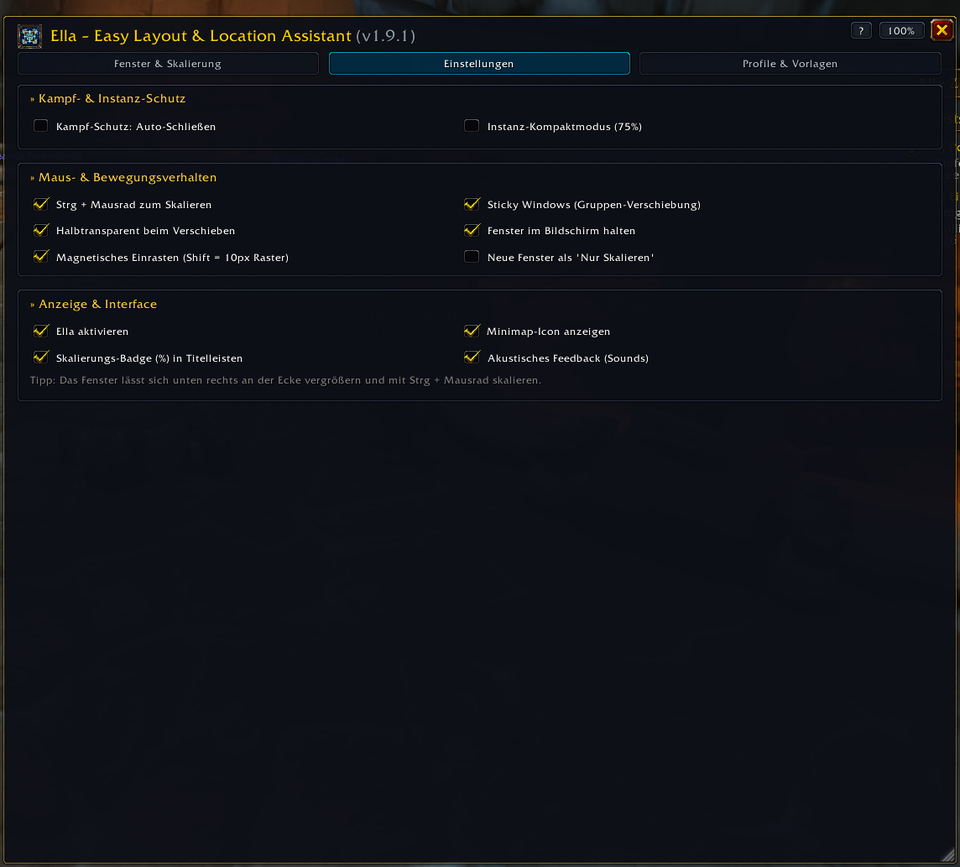
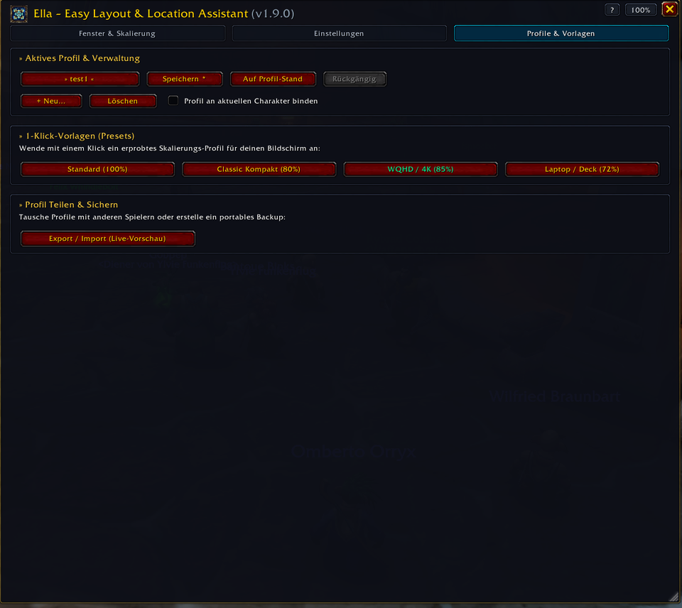

# EĹLA (`Ella`) – Easy Layout & Location Assistant

<p align="center">
  
</p>

> **Per-Window UI Scaler & Position Memory for *World of Warcraft: Forever* (`Interface: 16001` / `Project Camelot`)**

[-ffaa00?logo=github)](https://github.com/Avacon00/ELLA/releases/latest)
[](https://github.com/Avacon00/ELLA/actions/workflows/lint.yml)
Offizieller Zielclient / Official target client: **World of Warcraft: Forever (Camelot)**. Standard/Retail liegt außerhalb des Supportumfangs / is outside the support scope.


[](LICENSE)

**EĹLA** (**E**asy **L**ayout & **L**ocation **A**ssistant — im Spiel aufgrund von Blizzards `Friz Quadrata`-Schriftart sauber als **`Ella`** dargestellt) löst eines der größten UI-Probleme in **World of Warcraft: Forever**: Moderne Retail-Menüfenster (Berufe, Zauberbuch, Questlog, Auktionshaus, Ruf) wirken überdimensioniert, während die globale UI-Skalierung sofort auch Chat, Tooltips und Aktionsleisten unleserlich klein macht.

---

## In-Game Showcase & Live-Vorschau

<p align="center">
  <a href="assets/screenshots/01-ingame-overview.png">
    
  </a>
  <br />
  <em><b>Live im Spiel:</b> Charakterfenster (<code>86%</code>) &amp; Berufe (<code>82%</code>) kompakt übereinander an der leuchtenden <b>Cyan-Hilfslinie</b> ausgerichtet – während Aktionsleisten, Chat und Minimap bei <code>100%</code> gestochen scharf bleiben. Rechts der ruhige <b>Dark-Slate Fenster-Manager</b> mit Echtzeit-Zähler <code>Offen (2)</code>.</em>
</p>

<table>
  <tr>
    <td width="50%" valign="top" align="center">
      <a href="assets/screenshots/02-badge-popover.png">
        
      </a>
      <br />
      <b>Direktes Titelleisten-Popover (<code>86%</code>)</b><br />
      <sub>Größe (<code>50%–150%</code>), Deckkraft (<code>30%–100%</code>), <i>Mouseover-Fade</i>, <i>Nur Skalieren</i> &amp; Positionssperre direkt am jeweiligen Spielfenster.</sub>
    </td>
    <td width="50%" valign="top" align="center">
      <a href="assets/screenshots/03-magnetic-docking.png">
        
      </a>
      <br />
      <b>Magnetisches Einrasten &amp; Sticky Windows</b><br />
      <sub>Fenster docken kantenbündig mit live leuchtenden Cyan-Leitlinien aneinander an und lassen sich als Verbund verschieben.</sub>
    </td>
  </tr>
  <tr>
    <td width="50%" valign="top" align="center">
      <a href="assets/screenshots/04-manager-filters.png">
        
      </a>
      <br />
      <b>8 Echtzeit-Kategorien &amp; Live-Vorschau</b><br />
      <sub>Dynamische Zähler (<code>Offen (2)</code>), sofortige Filterung (z. B. <i>Berufe</i>), farbcodierte Modi &amp; grüne 1-Klick-Vorschau-Augen.</sub>
    </td>
    <td width="50%" valign="top" align="center">
      <a href="assets/screenshots/07-interactive-tutorial.png">
        
      </a>
      <br />
      <b>Geführtes 13-Schritte-Tutorial (<code>/ella tour</code>)</b><br />
      <sub>Interaktive Einführung mit sanft abgedunkelter Spielwelt, automatischer Reiter-Wahl und Cyan-Spotlight-Rahmen.</sub>
    </td>
  </tr>
  <tr>
    <td width="50%" valign="top" align="center">
      <a href="assets/screenshots/05-manager-settings.png">
        
      </a>
      <br />
      <b>Aufgeräumte Einstellungen &amp; Kampfschutz</b><br />
      <sub>Kampf-Auto-Schließen, 75%-Instanz-Kompaktmodus, Strg+Mausrad-Zoom, Bildschirm-Clamping &amp; natives Sound-Feedback.</sub>
    </td>
    <td width="50%" valign="top" align="center">
      <a href="assets/screenshots/06-manager-profiles.png">
        
      </a>
      <br />
      <b>Profile, 1-Klick-Presets &amp; <code>!ELLA:v2:</code>-Sharing</b><br />
      <sub>Charakter-Bindung, geschützte Profil-Checkpoints, 25-stufiges <i>Rückgängig</i> &amp; String-Import mit Live-Vorschau.</sub>
    </td>
  </tr>
</table>

---

## Deutsch (Übersicht & Bedienung)

### Praxis-Beispiele: Was EĹLA im Alltag besonders macht
* **1. WQHD / Ultrawide „Multi-Window“ Handwerk & Handel:** Öffne *Berufe (`82 %`)*, *Charakterinfo (`86 %`)* und *Auktionshaus (`84 %`)* gleichzeitig nebeneinander, ohne dass riesige Retail-Fenster den halben Bildschirm verdecken. Über **Magnetisches Einrasten** & **Sticky Windows** rasten ihre Oberkanten pixelgenau auf einer Linie ein und gleiten beim Ziehen gemeinsam als Gruppe.
* **2. „Blizzards Auto-Anordnung behalten – nur endlich kompakt“ (`Nur Skalieren`):** Du liebst es, dass WoW Charakterfenster und Händler automatisch ordentlich nebeneinander aufklappt, findest die Panels aber viel zu klobig? Im Modus **Nur Skalieren** bleibt Blizzards `UIPanel`-Mechanik zu 100 % aktiv, öffnet jedes Fenster aber knackig auf z. B. `80 %` – völlig ohne verkleinerte Aktionsleisten oder unscharfen Chat.
* **3. Volle Übersicht in Dungeons & Raids (`Kampf-Schutz` + `75 %-Deckel` + `Boss-Key`):** Sobald ein Pull startet, schließt der optionale **Kampf-Schutz** offene Berufsfenster oder das Questlog automatisch. Im **Instanz-Kompaktmodus** werden Fenster in Dungeons/Raids temporär auf maximal `75 %` gedeckelt und draußen automatisch wieder auf deine Wunschgröße gesetzt. Und mit dem **Boss-Key** (`/ella panic`) räumst du mit einem Tastendruck alle offenen Fenster weg – ein zweiter Druck holt exakt dieselben Fenster wieder zurück!
* **4. Steam Deck, Laptop & Twink-Setups (`72 %`-Preset + `Mouseover-Fade`):** Auf kompakten Auflösungen (`≤ 1400×800`) schlägt Ella beim ersten Login automatisch das **Laptop / Deck (72 %)**-Preset vor. Kombiniert mit **Mouseover-Fade** kann z. B. das Questlog dezent bei `55 %` Deckkraft mitlaufen und blendet erst beim Überfahren mit der Maus weich auf `100 %` auf (`0,00 ms` Ruhe-CPU).

### Highlights
* **Dedizierte Drittanbieter-AddOn-Steuerung & Individuelles `%`-Badge (`v1.10.0`):**
  * *1-Klick-Schalter `[• Aktiv]` / `[Aus]` pro AddOn:* Entscheide pro Drittanbieter-AddOn mit einem Klick, ob Ella es verwalten soll oder ob es auf **`Aus`** zu 100 % unberührt bleibt (keine `SetPoint`-/`SetScale`-Konflikte nach `/reload` bei AddOns mit eigener Positionslogik!).
  * *Individuelles `%`-Badge & Rahmenloser Außen-Anker:* Schalte das `%`-Badge für einzelne AddOns (z. B. kleine Seiten-AddOns wie *Auto Heal*) direkt per `Alt + Klick` auf das Badge, im Badge-Popover oder über den `[%]`-Button in `/ella` ein oder aus. Ist es aktiv, sitzt es bei rahmenlosen AddOns sauber außen an der Oberkante statt im Klickbereich.
* **Dark-Slate UI-Überarbeitung, Typografie & Engine-Härtung (`v1.9.0`–`v1.9.1`):**
  * *Ruhiges Flat-UI in der Fensterliste:* Maßgeschneiderte dunkle Slate-Steuerelemente statt greller Blizzard-Rot-Buttons – mit semantischen Modusfarben (**Smaragdgrün** für *Skalieren + Bewegen*, **Bernsteingold** für *Nur Skalieren*, **Schiefergrau** für *Deaktiviert*) und Gold-/Cyan-Akzenten bei abweichender Skalierung.
  * *Echte deutsche Typografie:* 100 % saubere Umlaute (`ä`, `ö`, `ü`, `ß`) in allen Menüs, Tooltips, Dialogen und allen 13 Tutorial-Schritten.
  * *Persistentes Ausrichtungsgitter & 8 Filter-Kategorien:* Das Screen-Grid bleibt auch nach dem Schließen des Managers aktiv (inklusive leuchtendem Cyan-Aktivstatus auf `[# Gitter]`); neuer eigener Filter-Reiter **`Forever`** sowie kontextsensitive Leerzustände.
  * *2-Klick-Sicherheitsbestätigung & Gruppen-Clamping:* Schutz vor versehentlichem `Alle Reset` oder Profil-Löschen direkt auf dem Button; angedockte Sticky-Window-Gruppen gleiten am Bildschirmrand synchron ohne Versatz.
  * *Gehärteter Picker 2.0 & EditMode-Schutz:* Automatische Bereinigung verwalteter Blizzard-Container (`RightManagedFrameContainer` u. a.) sowie vollständige `ESC`-Unterstützung in allen Popups, Popovern und Dialogen.
* **Audio- & Haptisches Feedback (`v1.8.0`):** Native Blizzard-Soundeffekte beim magnetischen Einrasten (Snap-Sound), Boss-Key, Profil- und Preset-Wechsel sowie Gitter-Umschaltung. Vollständig abschaltbar unter *Einstellungen*.
* **Dynamische Echtzeit-Filterzähler (`v1.8.0`):** Die Kategorie-Tabs im Manager zeigen in Echtzeit an, wie viele Fenster gerade offen sind (`Offen (2)`) bzw. wie viele eigene Drittanbieter-Fenster existieren (`Custom (1)`).
* **Minimap-Schnellauswahl & Shift+Klick (`v1.7.3`):** Eigenständiges, ausfallsicheres Popover direkt an der Minimap mit Außenklick-Schließung, Profil-Schnellwechsler, 1-Klick-Presets und Schnellstartern (Picker, Gitter, Tutorial). Halte `Shift` gedrückt und klicke auf das Icon, um sofort zum nächsten Profil durchzuschalten!
* **Erweitertes 13-Schritte Onboarding-Tutorial (`v1.7.2`):** Vollständig ausgebaute, geführte Tour (`/ella tour`) mit automatischer Reiter-Navigation und Scheinwerfer-Spotlight über alle 3 Hauptbereiche.
* **Entzerrte 3-Reiter-Benutzeroberfläche (`v1.7.1`):** Übersichtliche Aufteilung des Managers in *Fenster & Skalierung*, *Einstellungen* und *Profile & Vorlagen* mit über 120px mehr vertikalem Platz (12–14 Fensterzeilen gleichzeitig ohne Scrollen sichtbar).
* **Screen-Grid Overlay (`v1.7.0`):** Schalte per Klick auf `[# Gitter]` im Manager, in der Minimap-Schnellauswahl oder per `/ella grid` ein dezentes Vollbild-Ausrichtungsgitter mit leuchtendem Zentrum-Kreuz (Cyan), Drittel-Achsen (Gold) und 32px-Raster ein.
* **Profil-Sharing 2.0 mit Live-Vorschau (`v1.7.0`):** Teile deine Layouts blitzschnell via `!ELLA:v2:`-Codes. Beim Einfügen analysiert Ella den String sofort und zeigt eine Infobox mit Profilnamen und enthaltenen Fenstern an, bevor du ihn übernimmst.
* **Boss-Key & Panik-Aktion (`v1.7.0`):** Ein einziger Tastendruck schließt alle aktuell offenen Fenster blitzschnell – ein zweiter Tastendruck stellt genau dieselben Fenster wieder an Ort und Stelle her! Frei belegbar in Blizzards Menü (*Tastenbelegung* -> *AddOns* -> *Ella*) oder per `/ella panic`.
* **Kampf- & Instanz-Schutz (`v1.6`):**
  * *Auto-Close im Kampf:* Schließt ungeschützte Menüs, Zauberbuch und Berufsfenster beim Kampfeintritt (`PLAYER_REGEN_DISABLED`) sofort automatisch.
  * *Instanz-Kompaktmodus:* Begrenzt geöffnete Fenster in Dungeons, Raids und PvP-Instanzen vorübergehend auf maximal 75 % Skalierung. Beim Verlassen wird deine Wunschskalierung nahtlos wiederhergestellt.
* **Synchrones Fenster-Docking & Sticky Windows (`v1.6`):**
  * Aneinanderliegende oder bündige Fensterkanten (`≤ 16 px`) docken automatisch aneinander an und bewegen sich synchron als Gruppe!
  * Halte `[Alt]` beim Ziehen gedrückt, um ein einzelnes Fenster aus der Gruppe zu lösen.
* **Vor-Registrierte Community-AddOns (`v1.6`):**
  * Vorkonfigurierte Unterstützung für *Details! Damage Meter*, *Questie*, *Bagnon / Baganator*, *ThreatClassic2*, *TomTom*, *WeakAuras*, *Auctionator*, *AtlasLoot* und *Postal* (erscheinen automatisch, sobald das jeweilige AddOn geladen ist).
* **Fenster-Picker 2.0 (`v1.5`):** Visuelle Drittanbieter-Erkennung mit Live Hover-Highlighter, schwebendem Cursor-HUD und **Mausrad-Hierarchie-Navigation** (`Child` <-> `Parent`), um verschachtelte AddOns zielsicher aufzunehmen.
* **Fenster-Deckkraft & Mouseover-Fade (`v1.4`):** Passe die Transparenz jedes Fensters stufenlos (`30 %` – `100 %`) an. Mit *Mouseover-Fade* bleiben Fenster dezent durchscheinend, bis du mit der Maus darüberfährst (0,00 ms Leerlauf-CPU).
* **Charakter-gebundene Profile & Handheld-Erkennung (`v1.4`):** Binde Layout-Profile direkt an deine Charaktere. Auf kompakten Displays wie dem Steam Deck (`≤ 1400×800`) schlägt Ella automatisch das handliche 72%-Preset vor.
* **Einzel-Fenster-Skalierung (`50 %` – `150 %`) & Cursor-Pivot-Zoom:** Skaliere jedes Blizzard- und *WoW: Forever*-Fenster individuell über das `%`-Badge in der Titelleiste, per `Strg + Mausrad` oder im `/ella`-Manager – der Punkt unter deinem Mauszeiger bleibt dabei pixelgenau fixiert.
* **„Nur Skalieren“-Modus (`Scale Only`):** Behalte Blizzards automatische Nebeneinander-Anordnung bei, öffne jedes Fenster aber in deiner kompakten Wunschgröße (auch als globaler Standard für neue Fenster wählbar).
* **100 % Taint-frei & Edit-Mode-sicher:** Ignoriert konsequent alle HUD- und Kampfelemente aus Blizzards `EditModeManagerFrame`, reiht geschützte Fenster im Kampf sicher in eine Warteschlange ein (`InCombatLockdown()`) und verursacht **0,00 ms CPU-Last im Ruhezustand**.

### Chat-Befehle
| Befehl | Funktion |
| :--- | :--- |
| `/ella` | Öffnet bzw. schließt den durchsuchbaren **Ella Fenster-Manager** |
| `/ella tour` | Startet das interaktive **13-Schritte-Tutorial** |
| `/ella grid` | Schaltet das **Vollbild-Ausrichtungsgitter** ein oder aus |
| `/ella panic` | **Boss-Key:** Schließt alle offenen Fenster oder stellt sie wieder her |
| `/ella profile <Name>` | Wechselt zum angegebenen Layout-Profil (ohne Namen: nächstes Profil durchschalten) |
| `/ella compact` | Aktiviert sofort das **Classic Kompakt (80 %)**-Preset |
| `/ella pick` | Startet den interaktiven **Fenster-Picker 2.0** für Drittanbieter-Fenster |
| `/ella undo` | Macht die letzte Skalierungs- oder Positionsänderung rückgängig (bis zu 25 Schritte) |
| `/ella badges` | Blendet die `%`-Badges in den Fenstertitelleisten ein oder aus |
| `/ella reset` | Setzt alle Fensterskalierungen und Positionen auf `100 %` zurück |
| `/ella test` | Führt den integrierten 6-Punkte-Selbsttest zur Diagnose aus |

---

## English (Overview & Usage)

### Real-World Setup Examples: What Makes EĹLA Special
* **1. Side-by-Side Crafting & Economy Hub:** Shrink oversized modern *Professions (`82%`)*, *Character (`86%`)*, and *Auction House (`84%`)* frames to crisp Classic proportions. Snap their top edges together via live **Cyan Alignment Guides**, and move docked panels together as a single unit with **Sticky Windows** (hold `Alt` to detach).
* **2. Keep Blizzard's Auto-Push Layout (`Scale Only` Mode):** Want Blizzard's native side-by-side `UIPanel` arrangement without massive Retail panels? Switch individual windows (or all new windows by default) to **Scale Only** — Blizzard still manages positioning while EĹLA applies your exact custom scale, leaving chat, tooltips, and Edit Mode HUD bars untouched at `100%`.
* **3. Dungeon & Raid Awareness (`Combat Auto-Close` + `75% Cap` + `Boss-Key`):** Automatically close open quest/profession menus on pull (`PLAYER_REGEN_DISABLED`), cap large panels at `75%` inside instances while restoring your personal sizes outside, or hit your **Boss-Key** (`/ella panic`) once to clear all open panels and press again to bring those exact windows back.
* **4. Steam Deck, Laptop & Multi-Spec Profiles (`72%` Preset + `Mouseover Fade`):** Compact screens (`≤ 1400×800`) automatically offer the tailored **Laptop / Deck (72%)** preset on first login. Combine character-bound profiles with **Mouseover Fade** (`30%–100%` opacity, `0.00 ms` idle CPU) and instant `Shift + Click` cycling on the Minimap button.

### Key Features
* **Per-AddOn On/Off Control & Individual `%`-Badge Toggle (`v1.10.0`):**
  * *1-Click `[• Active]` / `[Off]` Toggle per Window:* Leave Ella active on the third-party AddOns you want to scale/move while setting others with their own position memory to **`Off`** (100% hands-off across `/reload` — zero `SetPoint`/`SetScale` conflicts!).
  * *Per-Window `%`-Badge Toggle & Frameless Exterior Anchor:* Hide or show the `%`-badge on specific windows/AddOns (such as compact sidebars like *Auto Heal*) via `Alt + Click` on the badge, inside the badge popover, or via the `[%]` button in `/ella`. When visible on frameless AddOns, the badge anchors cleanly outside the top edge instead of inside clickable buttons.
* **Dark-Slate UI Polish, Engine Hardening & UX Refinement (`v1.9.0`–`v1.9.1`):**
  * *Custom Dark-Slate Row Controls:* Replaces repetitive red Blizzard buttons inside the scroll list with sleek flat Dark-Slate controls and semantic mode colors (**Emerald** for *Scale + Move*, **Amber Gold** for *Scale Only*, **Muted Slate** for *Disabled*) plus gold/cyan scale indicators.
  * *Persistent Alignment Grid & 8 Filter Pills:* The full-screen alignment grid now stays active after closing the manager so you can arrange game windows unobstructed (with glowing cyan active states on `[# Grid]`), joined by a dedicated **`Forever`** category pill and contextual empty-state helpers.
  * *Two-Click Inline Safety & Rigid Group Clamping:* Destructive actions (`Reset All`, `Delete Profile`) require a quick second confirmation click; docked Sticky Window clusters clamp rigidly at screen boundaries without breaking relative alignment.
  * *Hardened Picker 2.0 & EditMode Protection:* Expanded blacklist and automatic cleanup for Blizzard managed containers (`RightManagedFrameContainer`, etc.), plus universal `ESC` close support across all popovers and dialogs.
* **Audio Feedback & Sound Engine (`v1.8.0`):** Native Blizzard sound effects for magnetic edge snapping, Boss-Key panics, profile cycling, button clicks, and distinct grid on/off cues. Fully toggleable in *Settings*.
* **Dynamic Real-Time Category Counters (`v1.8.0`):** Live counts on manager category pills (`Open (2)`, `Custom (1)`) with zero-latency event updates.
* **Minimap Quick Menu & Shift+Click Cycle (`v1.7.3`):** Native, zero-taint popover anchored to the Minimap button with outside-click dismissal, quick profile switching, 1-click presets, and tool launchers (picker, grid, tutorial). Hold `Shift` and click the icon to instantly cycle through profiles!
* **Expanded 13-Step Onboarding Tutorial (`v1.7.2`):** Comprehensive guided interactive walkthrough (`/ella tour`) featuring automatic tab switching and spotlighting across all 3 main areas.
* **De-Cluttered 3-Tab Architecture (`v1.7.1`):** Clean separation into *Windows & Scale*, *Settings*, and *Profiles & Presets* with >120px more vertical height for up to 14 rows visible simultaneously.
* **Screen-Grid Overlay (`v1.7.0`):** Toggle a full-screen alignment grid (`[# Grid]` button or `/ella grid`) featuring a glowing cyan center crosshair, golden rule-of-thirds lines, and 32px precision grid lines.
* **Profile-Sharing 2.0 with Live Preview (`v1.7.0`):** Share your window layouts via `!ELLA:v2:` string codes. Pasting a string instantly previews the profile name and configured windows before importing.
* **Boss-Key & Panic Restore (`v1.7.0`):** Instantly closes all open windows on a single key press, and pressing it again restores those exact windows. Bindable via WoW Keybindings (`Options` -> `Keybindings` -> `AddOns` -> `Ella`) or `/ella panic`.
* **Combat & Instance Protection (`v1.6`):**
  * *Combat Auto-Close:* Automatically closes open unprotected menus, spellbook, quests, and profession windows upon entering combat (`PLAYER_REGEN_DISABLED`).
  * *Instance Compact Mode:* Temporarily caps open windows to 75% max scale inside dungeons, raids, and PvP instances, seamlessly restoring personal scales on exit.
* **Sticky Window Docking & Group Dragging (`v1.6`):**
  * Windows touching edge-to-edge (`≤ 16 px`) dock together and move synchronously as a group (hold `[Alt]` while dragging to detach a single window).
* **Pre-Registered Community AddOns (`v1.6`):**
  * Built-in support for *Details!*, *Questie*, *Bagnon / Baganator*, *ThreatClassic2*, *TomTom*, *WeakAuras*, *Auctionator*, *AtlasLoot*, and *Postal* with zero overhead when uninstalled.
* **Window Picker 2.0 (`v1.5`):** Visual third-party inspector with real-time hover highlight, floating cursor HUD, and mouse-wheel hierarchy navigation (`Child` <-> `Parent`).
* **Per-Window Opacity & Mouseover Fade (`v1.4`):** Customize panel transparency (`30%` – `100%`) with smart mouseover fade-in and **0.00 ms idle CPU**.
* **Character-Bound Profiles & Handheld Auto-Detection (`v1.4`):** Bind profiles per character and enjoy automatic Steam Deck (`≤ 1400×800`) detection with tailored 72% handheld presets.
* **Individual Window Scaling (`50%` – `150%`), Cursor-Pivot Math & Scale-Only Mode:** Resize any Blizzard or *WoW: Forever* panel independently without coordinate drift, or keep Blizzard's side-by-side `UIPanel` push layout active while shrinking panels to Classic proportions.
* **Zero-Taint & Bilingual Out of the Box:** Strictly isolated from `EditModeManagerFrame` HUD elements, combat-lockdown safe, **0.00 ms idle CPU**, and 100% English (`enUS`) and German (`deDE`) parity.

### Slash Commands
| Command | Description |
| :--- | :--- |
| `/ella` | Opens or closes the searchable **Ella Window Manager** |
| `/ella tour` | Starts the interactive **13-step onboarding tutorial** |
| `/ella grid` | Toggles the full-screen **alignment grid overlay** |
| `/ella panic` | **Boss-Key:** Immediately closes or restores open windows |
| `/ella profile <Name>` | Switches to the named profile (or cycles to the next profile if omitted) |
| `/ella compact` | Applies the **Classic Compact (80%)** preset |
| `/ella pick` | Starts **Window Picker 2.0** to register third-party addon frames |
| `/ella undo` | Reverts the last scale or position change (up to 25 steps) |
| `/ella badges` | Shows or hides the `%` pills on window titlebars |
| `/ella reset` | Resets all window scales and positions back to `100%` |
| `/ella test` | Runs the built-in 6-point in-game diagnostic self-test |

---

## Installation & Download

> [!IMPORTANT]
> **Wichtig beim manuellen Download / Manual Download Note:**  
> Lade immer das fertige **`ELLA-v1.10.0-16001.zip`** unter **[GitHub Releases](https://github.com/Avacon00/ELLA/releases/latest)** herunter *(nicht über den grünen Button `<> Code -> Download ZIP`, da dieser den Ordner `ELLA-main` nennt und WoW ihn sonst nicht lädt)*.

### 1. Manuelle Installation (Windows / macOS / Linux)
1. Lade **[`ELLA-v1.10.0-16001.zip`](https://github.com/Avacon00/ELLA/releases/latest)** herunter.
2. Entpacke den enthaltenen Ordner `ELLA` in dein *WoW: Forever*-`AddOns`-Verzeichnis, sodass folgender Pfad existiert:
```text
World of Warcraft/_forever_/Interface/AddOns/ELLA/ELLA.toc
```

### 2. AddOn-Manager per GitHub-URL (z. B. WoWUp)
In GitHub-fähigen AddOn-Managern (*AddOn über URL installieren* / *Install from URL*) einfach die Repository-Adresse eintragen:
```text
https://github.com/Avacon00/ELLA
```

### 3. Linux Development Symlink (Faugus / Lutris / Steam / Bottles / Wine)
Für lokale Entwicklung unter Linux verlinkt das mitgelieferte Skript das Repository direkt in deine `_forever_`-Installation (Änderungen sind sofort per `/reload` im Spiel aktiv):
```bash
./scripts/link-addon.sh "/pfad/zu/World of Warcraft/_forever_/Interface/AddOns"
```

Release-Archiv lokal bauen & Regelwerk-Tests ausführen:
```bash
python3 tests/validate_addon.py
python3 scripts/build-release-zip.py
```

---

Details zu Schema, Migrationen und Reparatursicherungen: [SavedVariables](docs/SAVEDVARIABLES.md).
Unterstützte Profilformate und Importgrenzen: [Profilimport](docs/PROFILE-IMPORT.md).

## Projektstruktur / Architecture

```text
ELLA/
├── ELLA.toc                 # Interface: 16001, AllowLoadGameType: camelot
├── Bindings.xml             # Blizzard Tastenbelegung (Kategorie ADDONS: Boss-Key, Manager, Gitter)
├── Media/
│   └── Icon.tga             # Custom 256x256 Addon-Icon (Addon-Liste, Minimap & UI)
├── assets/                  # Hero-Banner, CurseForge-Avatar & In-Game-Screenshots (nur Repo/Web)
├── Libs/
│   └── LibStub/             # Eingebettete Public-Domain Bibliothek
├── Locales/
│   ├── enUS.lua             # Englische Lokalisierung (Fallback)
│   └── deDE.lua             # Deutsche Lokalisierung (100% Parität & echte Umlaute)
├── Core/
│   ├── Init.lua             # Namespace, Sound-Engine, SavedVariables-Initialisierung
│   ├── Database.lua         # Schema v2, versionierte Migrationen und Wiederherstellung
│   ├── Guard.lua            # Anti-Taint-Wächter, EditMode-Blacklist & Combat-Queue
│   ├── Registry.lua         # Deklarative Fenster- & Preset-Registrierung + LoD-Loader
│   ├── Engine.lua           # Cursor-Pivot-Zoom, Magnetic-Snap, Sticky-Docking & Boss-Key
│   └── Profiles.lua         # Benannte Profile, Undo-Stack & Export/Import (!ELLA:v2:)
├── Data/
│   ├── Frames_Core.lua      # Immer geladene Standardfenster (Charakter, Quest, Ruf...)
│   ├── Frames_LoD.lua       # Load-on-Demand-Module (Berufe, Zauberbuch, AH, Talente...)
│   └── Frames_Forever.lua   # WoW: Forever Spezialfenster & Community-AddOns
├── UI/
│   ├── Badge.lua            # UIParent-isoliertes Titelleisten-Badge (%) & Popover-Slider
│   ├── GridOverlay.lua      # Persistentes Vollbild-Ausrichtungsgitter (Zentrum & Drittel)
│   ├── HandheldDialog.lua   # Kompakt-/Steam-Deck-Erkennung (<= 1400x800) & 72%-Empfehlung
│   ├── MinimapButton.lua    # Natives Minimap-QuickMenu, LDB & Shift+Klick-Durchschaltung
│   ├── Picker.lua           # Interaktiver "/ella pick" Inspektor + Hierarchie-Navigation
│   ├── SettingsPanel.lua    # 3-Reiter Dark-Slate Fenster-Manager (/ella) mit 8 Filter-Tabs
│   ├── Tutorial.lua         # Interaktives 13-Schritte Onboarding-Tutorial (/ella tour)
│   └── WelcomeDialog.lua    # Einmaliger Erststart-Dialog zur Preset-Wahl
└── API/
    └── PublicAPI.lua        # Öffentliche Drittanbieter-API (ELLA_API & LibStub("ELLA-1.0"))
```

---

## Third-Party Addon API (`ELLA_API`)

Andere Addon-Autoren können ihre eigenen Fenster mit wenigen Zeilen an **EĹLA** anbinden:

```lua
local api = _G.ELLA_API or (LibStub and LibStub("ELLA-1.0", true))
if api then
    api:RegisterWindow("MY_ADDON_MAIN", {
        addon = "MyAddon",
        frame = "MyAddonMainFrame",
        label = "My Addon Window",
        defaultCompactScale = 0.85,
    })
end
```

Weitere Details und das verbindliche **Goldene Regelwerk** für Pull Requests findest du in [CONTRIBUTING.md](CONTRIBUTING.md).

## License
Veröffentlicht unter der [MIT License](LICENSE).
