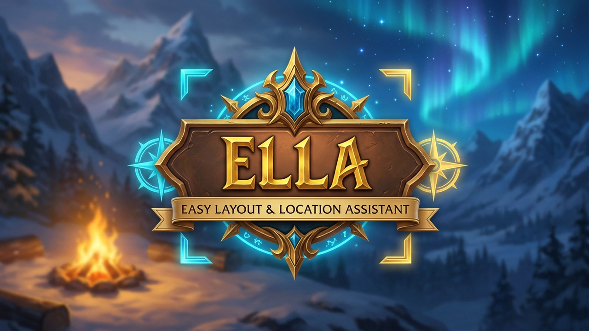

# EĹLA (`Ella`) – Easy Layout & Location Assistant

<p align="center">
  
</p>

> **Per-Window UI Scaler & Position Memory for *World of Warcraft: Forever* (`Interface: 16001` / `Project Camelot`)**


**EĹLA** (**E**asy **L**ayout & **L**ocation **A**ssistant — im Spiel aufgrund von Blizzards `Friz Quadrata`-Schriftart sauber als **`Ella`** dargestellt) löst eines der größten UI-Probleme in **World of Warcraft: Forever**: Moderne Retail-Menüfenster (Berufe, Zauberbuch, Questlog, Auktionshaus, Ruf) wirken überdimensioniert, während die globale UI-Skalierung sofort auch Chat, Tooltips und Aktionsleisten unleserlich klein macht.

---

## Deutsch (Übersicht & Bedienung)

### Highlights
* **Interaktives Einsteiger-Tutorial (`v1.2`):** Fragt beim ersten Aufruf von `/ella` freundlich nach (*„Kleines Tutorial gefällig?“*) und führt in einer 8-Schritte-Tour mit abgedunkeltem Hintergrund und leuchtenden Scheinwerfer-Rahmen durch alle Kernfunktionen (jederzeit über `[?]` oder `/ella tour` wiederholbar).
* **Einzel-Fenster-Skalierung (`50 %` – `150 %`):** Skaliere jedes Blizzard- und *WoW: Forever*-Fenster individuell über das dezente `%`-Badge in der Titelleiste, per `Strg + Mausrad` oder im `/ella`-Manager.
* **Benannte Layout-Profile (`v1.1`):** Wechsle per Klick im `/ella`-Manager oder per `/ella profile <Name>` blitzschnell zwischen verschiedenen Setups (z. B. `Default`, `Laptop / Deck`, `Raid`, `Twink`).
* **Magnetisches Einrasten & Live-Hilfslinien (`v1.1`):** Beim Ziehen richten sich Fenster sanft an der Bildschirmmitte sowie an Oberkanten und Seiten anderer offener Fenster aus (inklusive leuchtender Cyan-Hilfslinien, `Shift` = `10px`-Raster und optionaler Halbtransparenz beim Verschieben).
* **Begleitfenster-Synchronisation (`v1.1`):** Verknüpfte Unter- und Begleitfenster (z. B. `QuestLogPopupDetailFrame`, `TokenFramePopup`, `ProfessionsCustomerOrdersFrame`, `MacroPopupFrame`) übernehmen automatisch die Skalierung ihres Hauptfensters.
* **Cursor-Pivot-Zoom:** Beim Scrollen mit dem Mausrad bleibt der Punkt direkt unter deinem Mauszeiger pixelgenau an Ort und Stelle – kein Wegspringen von Fenstern.
* **„Nur Skalieren“-Modus (`Scale Only`):** Du magst es, dass WoW Charakterfenster und Händler automatisch ordentlich nebeneinander anordnet, findest die Fenster aber zu klobig? Im *Nur Skalieren*-Modus bleibt Blizzards Auto-Anordnung aktiv, öffnet aber jedes Fenster in deiner kompakten Wunschgröße.
* **1-Klick-Presets:** Sofort startklar mit **Classic Kompakt (80 %)**, **WQHD / 4K (85 %)** oder **Laptop / Deck (72 %)**.
* **Eigenes Addon-Icon (`Media/Icon.tga`):** Eigene handgefertigte Kompass-Anker-Grafik in der WoW-Addon-Liste, im Minimap-`AddonCompartment` und im Manager.
* **100 % Taint-frei & Edit-Mode-sicher:** Ignoriert konsequent alle HUD- und Kampfelemente aus Blizzards `EditModeManagerFrame`, reiht geschützte Fenster im Kampf sicher in eine Warteschlange ein (`InCombatLockdown()`) und verursacht **0,00 ms CPU-Last im Ruhezustand**.
* **In-Game Frame-Inspektor (`/ella pick`):** Nimm unbekannte Drittanbieter-Fenster per Mausklick auf – inklusive fertigem Lua-Code-Generator für GitHub-Beiträge.

### Chat-Befehle
| Befehl | Funktion |
| :--- | :--- |
| `/ella` | Öffnet bzw. schließt den durchsuchbaren **Ella Fenster-Manager** |
| `/ella tour` | Startet das interaktive **Schritt-für-Schritt-Tutorial** |
| `/ella profile <Name>` | Wechselt zum angegebenen Layout-Profil (ohne Namen: nächstes Profil durchschalten) |
| `/ella compact` | Aktiviert sofort das **Classic Kompakt (80 %)**-Preset |
| `/ella pick` | Startet den interaktiven **Frame-Inspektor** für Drittanbieter-Fenster |
| `/ella badges` | Blendet die `%`-Badges in den Fenstertitelleisten ein oder aus |
| `/ella reset` | Setzt alle Fensterskalierungen und Positionen auf `100 %` zurück |

---

## English (Overview & Usage)

### Key Features
* **Individual Window Scaling (`50%` – `150%`):** Resize any Blizzard or *WoW: Forever* panel independently via the optional titlebar `%` pill badge, `Ctrl + Mouse Wheel`, or `/ella`.
* **Named Layout Profiles (`v1.1`):** Create, copy, delete, and switch between multiple named window layouts (`Default`, `Laptop / Deck`, custom profiles) via `/ella` or `/ella profile <Name>`.
* **Magnetic Edge Snapping & Drag Opacity (`v1.1`):** Live cyan alignment guides snap windows cleanly to screen center, top edges, or side-by-side docking (`Shift` = `10px` grid), with optional semi-transparency while dragging.
* **Companion Sub-Frame Sync (`v1.1`):** Linked popups (`QuestLogPopupDetailFrame`, `TokenFramePopup`, `ProfessionsCustomerOrdersFrame`, `MacroPopupFrame`, etc.) automatically inherit their parent panel's scale.
* **Cursor-Pivot Math:** Zooming keeps the hovered UI coordinate anchored right beneath your cursor without coordinate drift.
* **Scale-Only Mode:** Keep Blizzard's automatic side-by-side `UIPanel` push layout while shrinking panels to crisp Classic proportions.
* **Zero-Taint & Edit Mode Quarantine:** Strictly isolated from `EditModeManagerFrame` HUD elements, queues protected frame changes safely during combat lockdown, writes zero properties onto Blizzard frames, and runs at **0.00 ms idle CPU**.
* **Bilingual Out of the Box:** Full English (`enUS`) and German (`deDE`) localization.

---

## Installation

### Standard (Windows / macOS / Linux)
Entpacke den Ordner `ELLA` in dein *WoW: Forever*-AddOns-Verzeichnis, sodass folgender Pfad existiert:
```text
World of Warcraft/_forever_/Interface/AddOns/ELLA/ELLA.toc
```

### Linux Development Symlink (Faugus / Lutris / Steam / Bottles / Wine)
Für lokale Entwicklung unter Linux verlinkt das mitgelieferte Skript das Repository direkt in deine `_forever_`-Installation (Änderungen sind sofort per `/reload` im Spiel aktiv):
```bash
./scripts/link-addon.sh "/pfad/zu/World of Warcraft/_forever_/Interface/AddOns"
```

Release-Archiv lokal bauen & Regelwerk-Tests ausführen:
```bash
python3 tests/validate_addon.py
python3 scripts/build-release-zip.py
```

---

## Projektstruktur / Architecture

```text
ELLA/
├── ELLA.toc                 # Interface: 16001, AllowLoadGameType: camelot, standard
├── Media/
│   └── Icon.tga             # Custom 256x256 Addon-Icon (Addon-Liste, Minimap & UI)
├── assets/                  # CurseForge Avatar (400x400) & Hero-Banner (nur Repo/Web)
├── Core/
│   ├── Init.lua             # Namespace, Konstanten, SavedVariables Schema v2 (ELLADB)
│   ├── Guard.lua            # Anti-Taint-Wächter, EditMode-Blacklist & Combat-Queue
│   ├── Registry.lua         # Deklarative Fenster- & Preset-Registrierung + LoD-Loader
│   ├── Engine.lua           # Cursor-Pivot-Zoom, Magnetic-Snap, Drag-Alpha & LinkedFrames
│   └── Profiles.lua         # Benannte Profile, Presets & ASCII Export/Import (ELLA1;...)
├── Data/
│   ├── Frames_Core.lua      # Immer geladene Standardfenster (Charakter, Quest, Ruf...)
│   ├── Frames_LoD.lua       # Load-on-Demand-Module (Berufe, Zauberbuch, AH, Talente...)
│   └── Frames_Forever.lua   # WoW: Forever Spezialfenster (Camping, Legacy, Fraktionen)
├── UI/
│   ├── Badge.lua            # UIParent-isoliertes Titelleisten-Badge (%) & Popover-Slider
│   ├── Picker.lua           # Interaktiver "/ella pick" Inspektor + GitHub-Snippet-Generator
│   ├── WelcomeDialog.lua    # Einmaliger Erststart-Dialog zur Preset-Wahl
│   └── SettingsPanel.lua    # Fenster-Manager (/ella), Blizzard-Optionen & AddonCompartment
└── API/
    └── PublicAPI.lua        # Öffentliche Drittanbieter-API (ELLA_API & LibStub("ELLA-1.0"))
```

---

## Third-Party Addon API (`ELLA_API`)

Andere Addon-Autoren können ihre eigenen Fenster mit wenigen Zeilen an **EĹLA** anbinden:

```lua
local api = _G.ELLA_API or (LibStub and LibStub("ELLA-1.0", true))
if api then
    api:RegisterWindow("MY_ADDON_MAIN", {
        addon = "MyAddon",
        frame = "MyAddonMainFrame",
        label = "My Addon Window",
        defaultCompactScale = 0.85,
    })
end
```

Weitere Details und das verbindliche **Goldene Regelwerk** für Pull Requests findest du in [CONTRIBUTING.md](CONTRIBUTING.md).

## License
Veröffentlicht unter der [MIT License](LICENSE).
